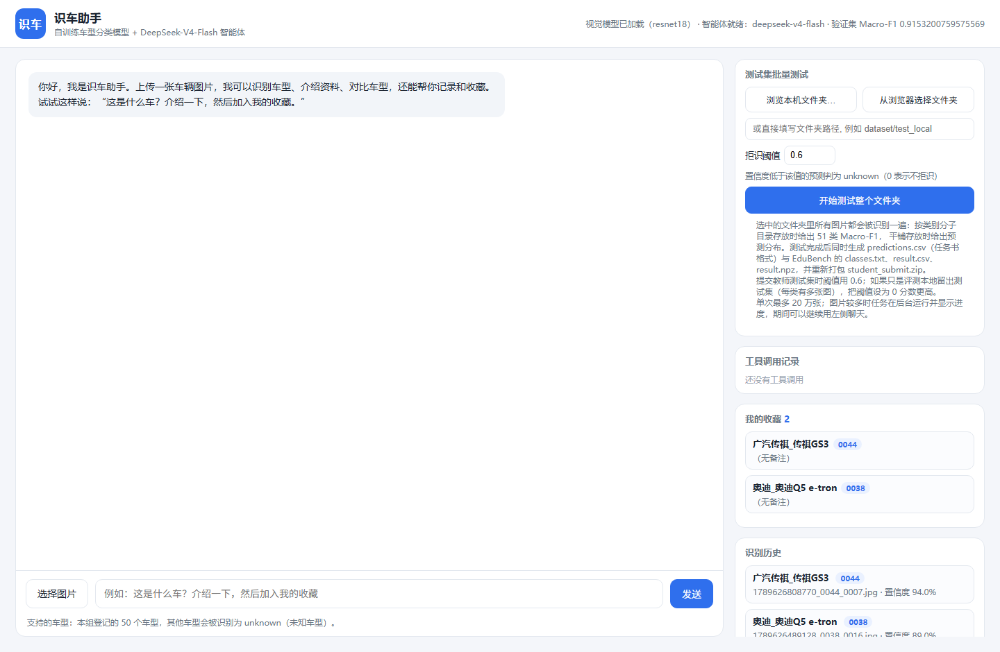
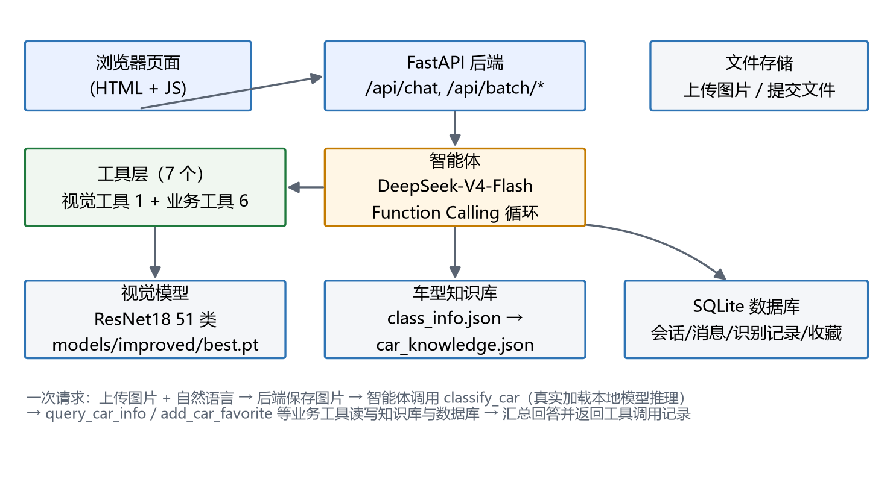
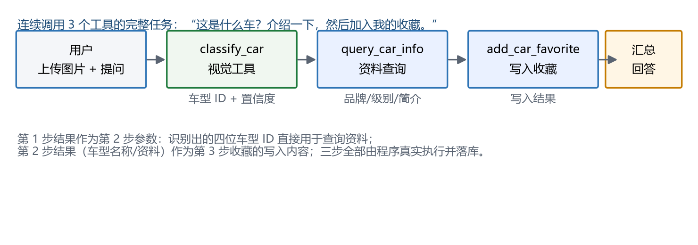
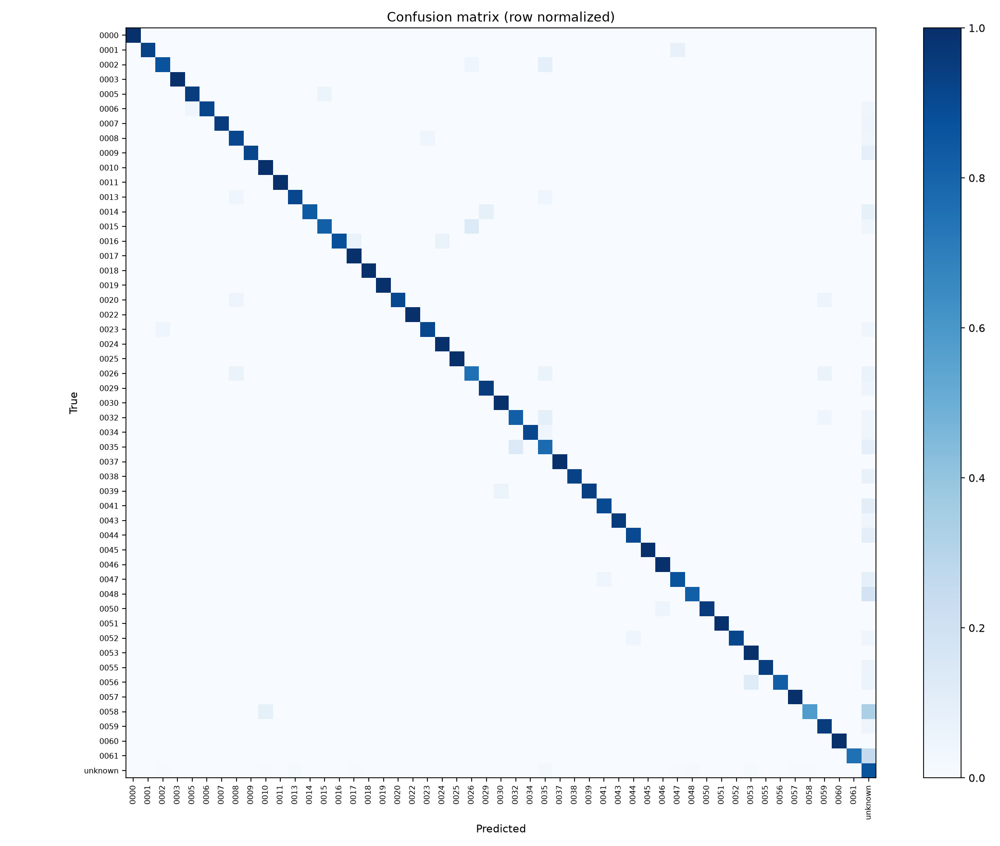

# 车型识别 Agent（识车助手）

面向二手车商收车与普通用户认车场景的智能体原型：上传一张车辆照片，用自然语言提问，系统完成"识别车型 → 查资料 → 对比 → 推荐相似车 → 加入收藏"的完整业务闭环。

识别部分是本项目自训练的 ResNet18 51 类分类模型（50 个目标车型 + unknown 拒识类），业务部分由 qwen-flash 通过 Function Calling 编排 9 个工具完成，后端 FastAPI + SQLite，前端为原生 HTML 页面。

这是一个本地运行的个人项目原型，不是企业级产品，没有真实用户和线上流量。



## 演示视频

[点击观看演示视频（video/car-agent-demo.mp4）](video/car-agent-demo.mp4)，覆盖识车、连续工具调用、低置信度确认与 unknown 拒识。

## 项目定位

项目的重点不是"识别一个车型名"，而是让识别结果真的参与后续业务。围绕这个目标处理三个产品问题：

1. 识别不确定时不能硬给结论——用双阈值把结果分成三档，低置信度只给候选让用户确认，unknown 直接说明不支持。
2. 业务写操作不能由模型随手触发——收藏只由用户明确指令触发，unknown 或低置信度时不执行写操作，避免脏数据。
3. 多轮对话要能承接上下文——用户只说"帮我记录下来""和刚才那辆比比"时，工具参数缺省回退到本会话最近一次识别结果，不需要重新上传图片。

## 系统架构

```
用户上传图片 + 自然语言提问
        │
        ▼
   FastAPI 后端  ──►  Agent 主流程（System Prompt + 工具调用循环 + 多轮上下文）
                          │
              ┌───────────┴───────────┐
              ▼                       ▼
       视觉工具 classify_car     8 个业务工具
       ResNet18 · 51 类          资料查询 / 检索 / 收藏 / 对比 / 推荐
              │                       │
              └───────────┬───────────┘
                          ▼
                   SQLite（会话 / 消息 / 识别记录 / 收藏）
```



## 技术栈

| 模块 | 技术 |
| --- | --- |
| 视觉模型 | PyTorch · ResNet18（ImageNet 预训练 + 全网络微调） |
| 大模型 | qwen-flash（阿里云百炼 OpenAI 兼容接口，Function Calling） |
| 智能体 | 自研工具调用循环（最多 6 轮）+ 多轮会话上下文 |
| 后端 | FastAPI + Uvicorn |
| 存储 | SQLite（会话、消息、识别记录、收藏） |
| 前端 | 原生 HTML + CSS + JavaScript |

## 工具清单（9 个）

| # | 工具 | 类型 | 功能 |
| --- | --- | --- | --- |
| 1 | `classify_car` | 视觉 | 调用自训练模型识别车型，返回类别 ID、名称、置信度、置信度档位与 Top-K 候选 |
| 2 | `query_car_info` | 业务 | 按 ID 或名称查询车型资料卡（品牌、车系、车身形式、级别） |
| 3 | `search_cars` | 业务 | 按品牌 / 级别 / 车身形式 / 关键词检索车型，用于"某类车有哪些"和对比前找候选 |
| 4 | `add_car_favorite` | 业务 | 加入收藏夹，支持备注；记录图片、置信度与置信度档位 |
| 5 | `remove_car_favorite` | 业务 | 从收藏夹删除，支持按名称或最近识别结果 |
| 6 | `list_car_favorites` | 业务 | 查看收藏夹列表（含低置信度标记） |
| 7 | `search_recognition_history` | 业务 | 检索历史识别记录 |
| 8 | `compare_cars` | 业务 | 两款车型属性对比，支持名称解析与多候选确认 |
| 9 | `recommend_similar_cars` | 业务 | 推荐同级别 / 同品牌相似车型 |

连续调用示例：用户说"这是什么车？介绍一下，然后加入我的收藏"，模型依次调用 `classify_car` → `query_car_info` → `add_car_favorite`，前一步结果直接成为下一步参数。



## 模型效果

模型为 ResNet18 迁移学习，51 类（50 车型 + unknown），输入 224×224，训练集 6211 张（50 类 4711 张 + unknown 1500 张），采用强数据增强 + 标签平滑 + 类别均衡采样。

| 评估集 | 样本量 | Macro-F1 | Accuracy | unknown 检出率 | 已知类误拒率 |
| --- | --- | --- | --- | --- | --- |
| 验证集（调参用） | 1338 | 0.9153 | 0.9051 | 0.8650 | 0.0405 |
| 本地留出测试集（不参与调参） | 922 | 0.8527 | 0.8384 | 0.7667 | 0.0691 |

消融对比（同一训练集、同一评估程序，只改增强与采样策略）：
基线弱增强 0.8246 → 强增强 + 标签平滑 0.9036 → 加类别均衡采样 0.9153。



主要误差来源：同品牌相邻车系（共享平台、差异集中在灯组与格栅细节）之间的混淆，以及组外车型与目标车型外形接近时被判成目标车型。

## 交互规则

- **双阈值三档**：置信度 ≥ 0.55 直接给结论；0.55 以下列出 Top-K 候选请用户确认；低于 0.25 或模型判为 unknown 时不按确定车型执行写操作。
- **unknown 不编造**：模型判为 unknown 时明确告知"不属于本组支持的 50 个车型"，不推测具体车型，不写收藏。
- **写操作由用户指令触发**：收藏只由用户明确说"记录 / 收藏"时执行，不自动入库。
- **上下文承接**：历史窗口截取对齐到用户消息开头，避免截断工具调用链；工具参数缺省时回退到最近一次识别结果。

## 目录结构

```
01_car_recognition_agent/
├── src/
│   ├── agent/          # agent.py 主流程 / tools.py 9 个工具 / llm.py 客户端 / database.py 存储
│   ├── web/            # app.py FastAPI 接口 + static 前端页面
│   ├── model.py        # ResNet18 + 51 类分类头
│   ├── dataset.py      # 数据读取与增强
│   ├── train.py        # 训练入口
│   ├── evaluate.py     # 评估：Macro-F1、混淆矩阵、错误分析
│   ├── metrics.py      # 指标计算
│   ├── infer.py        # 单张 / 批量推理
│   └── batch.py        # 批量测试与提交文件生成
├── scripts/            # 数据准备、知识库生成、环境安装、启动脚本
├── data/               # class_info.json 类别说明、car_knowledge.json 车型资料库
├── images/             # 项目截图
├── config.yaml         # 运行配置（阈值、模型路径、大模型配置）
├── classes.txt         # 50 个目标车型类别 ID
├── requirements.txt
└── .env.example        # API Key 配置示例
```

## 快速开始

```bash
# 1. 创建环境并安装依赖
python -m venv .venv
.venv\Scripts\activate
pip install -r requirements.txt

# 2. 配置 API Key（复制 .env.example 为 .env，填入 DASHSCOPE_API_KEY）

# 3. 启动 Web 服务
powershell -ExecutionPolicy Bypass -File scripts\start_web.ps1
# 浏览器访问 http://127.0.0.1:8000
```

模型权重不随仓库分发（约 44 MB）。训练与评估流程：

```bash
python scripts\build_dataset.py          # 生成 classes.txt 与数据集
python src\train.py --preset improved    # 训练
python src\evaluate.py --model models\improved\best.pt --split val
```

## 边界与不足

- 只识别本组登记的 50 个车型，其余输出 unknown；当前为 50 类封闭集原型，不是通用识车能力。
- 车型资料仅来自结构化字段（品牌、车系、车身形式、级别），不包含价格、动力、销量等参数。
- unknown 仅由 50 个组外来源类别抽样构成，对与目标车型外形接近的其余组外车型仍有误判。
- 训练在 CPU 上完成，输入尺寸与训练轮数受限；推理约 86 张/秒。
- 单机单用户本地部署，无用户体系与并发控制。

## 说明

本项目为个人独立完成的项目原型，开发过程使用了 AI 工具辅助。
